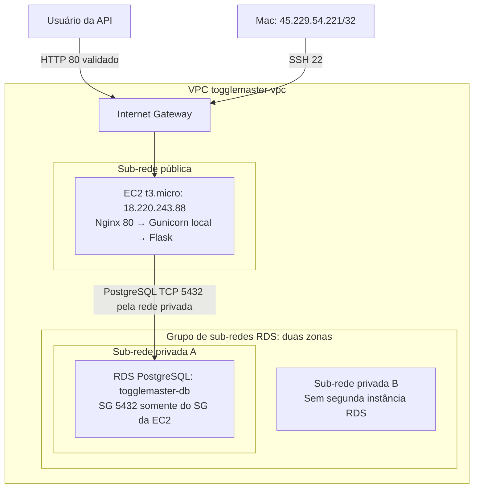

# Arquitetura AWS — fase 1

Atualização: 03/11/2026. Estado: EC2, RDS e API implantados e validados por HTTP em `us-east-2`. O SG permite 443, mas HTTPS ainda não foi configurado. Os CIDRs e rotas da tabela abaixo são os valores planejados, ainda não conferidos no console.

## Visão simples

O usuário acessa a EC2 pela internet na porta HTTP 80. Dentro da EC2, o Nginx encaminha ao Gunicorn em `127.0.0.1:5000`, que executa o código Flask original. A aplicação consulta o RDS PostgreSQL pela rede privada da VPC. O SG do RDS aceita a porta 5432 com origem no SG da EC2.

O Nginx é configuração de infraestrutura na mesma EC2, sem alteração em `app.py`. Ele atende a porta 80; a porta 443 está liberada no SG, mas ainda precisa de listener e certificado para oferecer HTTPS.

## Componentes e configuração

| Componente | Configuração | Motivo/estado |
| --- | --- | --- |
| Conta | AWS pessoal, confirmada pelo usuário | A estimativa considerará recursos pagos, sem presumir créditos ou gratuidade. |
| Região | `us-east-2` (Ohio) | Região atribuída ao projeto na experiência simplificada; mantida por decisão do usuário para evitar upgrade da conta. Estimativa revisada em 31/10/2026; consultar `CUSTOS_AWS.md`. |
| VPC | `togglemaster-vpc`, `10.0.0.0/16` | Isolar a rede do projeto. |
| Sub-rede pública | `togglemaster-public-a`, `10.0.1.0/24`, zona A | Hospedar a EC2. |
| Sub-rede privada A | `togglemaster-private-a`, `10.0.11.0/24`, zona A | Hospedar o RDS inicialmente. |
| Sub-rede privada B | `togglemaster-private-b`, `10.0.12.0/24`, zona B | Completar o grupo de sub-redes do RDS. |
| EC2 | `i-0c8f51662ac454703`, `t3.micro`, Amazon Linux 2023, IP `18.220.243.88`, AZ `us-east-2a` | Instância implantada e testada. |
| Disco EC2 | EBS gp3, 8 GiB, criptografado | Base inicial para sistema, código e dependências; confirmar mínimo da AMI. |
| Aplicação | Python em venv, Gunicorn em `127.0.0.1:5000`, serviço `togglemaster` | Implantada e validada; código original preservado. |
| Entrada web | Nginx na mesma EC2, HTTP 80 | Acesso público validado; HTTPS pendente. |
| Banco | RDS PostgreSQL `togglemaster-db`, banco `togglemaster`, AZ `us-east-2a` | Conexão e operações de escrita/leitura validadas; classe, versão e armazenamento ainda precisam ser conferidos no console. |
| Banco público | Não | Acesso pela rede privada a partir da EC2. |
| Banco e credenciais | Banco `togglemaster`; valores reais no ambiente da EC2 | Seguir a configuração fornecida; nunca versionar senha real. |
| Endereço público | IPv4 `18.220.243.88` | Acesso por IP confirmado; registrar mudanças após stop/start. |

Classes e volumes não confirmados no console continuam como proposta de orçamento. A aplicação local usa PostgreSQL 13; a versão efetiva do RDS deve ser registrada após conferência.

## Diagrama

Arquivo editável atualizado: [ARQUITETURA_AWS.drawio](ARQUITETURA_AWS.drawio). Abrir pelo diagrams.net e usar como base do diagrama da apresentação. O arquivo não possui vínculo automático com a conta AWS.

A linha pelo Internet Gateway representa o caminho de internet, não uma configuração de encaminhamento de portas nesse componente. As regras ficam nos Security Groups e os serviços escutam na EC2. O diagrama editável omite CIDRs e rotas ainda não conferidos no console.

Duas sub-redes privadas integram o grupo de sub-redes do RDS, conforme o console. Isso não ativa Multi-AZ nem cria réplica. Fonte: [RDS em uma VPC](https://docs.aws.amazon.com/AmazonRDS/latest/UserGuide/USER_VPC.WorkingWithRDSInstanceinaVPC.html).

## Rotas e endereçamento

| Tabela | Associação | Rotas |
| --- | --- | --- |
| `togglemaster-public-rt` | Sub-rede pública A | `10.0.0.0/16 → local`; `0.0.0.0/0 → Internet Gateway` |
| `togglemaster-private-rt` | Privadas A e B | `10.0.0.0/16 → local`; sem rota padrão para internet |

Associar o Internet Gateway à VPC e habilitar DNS resolution/DNS hostnames. A EC2 precisa de IPv4 público, rota ao gateway e regras de segurança para acesso externo. A comunicação EC2–RDS usa o endpoint DNS do RDS e IPs privados, sem passar pela internet. Fonte: [Internet Gateway](https://docs.aws.amazon.com/vpc/latest/userguide/VPC_Internet_Gateway.html).

Não há necessidade de NAT Gateway para o banco desta topologia; as atualizações da aplicação são baixadas pela EC2 pública. Não serão incluídos balanceador, contêineres na AWS ou Kubernetes nesta fase. Os componentes do diagrama correspondem à implantação manual exigida.

## Security Groups

### `togglemaster-ec2-sg` — associado à EC2 da aplicação

| Direção | Protocolo/porta | Origem/destino | Uso |
| --- | --- | --- | --- |
| Entrada | TCP 22 | `45.229.54.221/32` | SSH; atualizar se o IP do Mac mudar. |
| Entrada | TCP 80 | `0.0.0.0/0` | HTTP público. |
| Entrada | TCP 443 | `0.0.0.0/0` | Regra ativa; listener e certificado HTTPS ainda pendentes. |
| Saída | Padrão liberado para IPv4 | `0.0.0.0/0` | Download de dependências, DNS e conexão ao RDS. |

Não abrir a porta 5000 da aplicação no SG. O Nginx acessa o Gunicorn por loopback dentro da EC2.

### `togglemaster-rds-sg` — associado ao RDS

| Direção | Protocolo/porta | Origem | Uso |
| --- | --- | --- | --- |
| Entrada | TCP 5432 | SG da EC2: `sg-0204376560b94f163` | Somente a EC2 da aplicação acessa o PostgreSQL. |

Nenhuma outra regra de entrada no SG do RDS. A referência é ao ID do grupo, não ao IP público da EC2. Security Groups são stateful: o retorno de conexões permitidas não exige uma regra de saída espelhada. Fonte: [Regras de Security Groups](https://docs.aws.amazon.com/vpc/latest/userguide/security-group-rules.html).

## HTTP ativo e HTTPS pendente

O enunciado menciona HTTP/HTTPS no SG. As regras 80 e 443 estão ativas. O Nginx atende HTTP na porta 80 e encaminha ao Gunicorn local. O acesso público pelo IP foi validado em `/health` e nas operações de criação, consulta e atualização da API.

HTTPS exige configurar TLS e um certificado adequado ao endereço usado. Abrir 443 no SG sozinho não oferece HTTPS; não registrar HTTPS como concluído até testar o acesso. O PDF exige regras HTTP/HTTPS no SG e acesso público à aplicação por IP ou DNS; não exige um print da API.

Referência do proxy: [NGINX Reverse Proxy](https://docs.nginx.com/nginx/admin-guide/web-server/reverse-proxy). O Amazon Linux 2023 usa Python 3.9 como Python de sistema, compatível com o ambiente instalado: [Python no AL2023](https://docs.aws.amazon.com/linux/al2023/ug/python.html).

## Limites assumidos para esta fase

Uma EC2 e um banco em uma única AZ bastam para a demonstração acadêmica; não há alta disponibilidade da aplicação. A aplicação continua sem autenticação, conforme o código recebido. Não usar dados reais ou sensíveis na demonstração.

## Próximos passos e entrega

- Conferir no console os CIDRs, associações de rota, classe, versão e armazenamento reais; ajustar as informações planejadas do desenho se houver diferença.
- Decidir se HTTPS será configurado para a apresentação e, se for, obter endereço/certificado e testar a porta 443.
- Publicar o diagrama e registrar o link; o arquivo local editável já está nesta pasta.
- Gravar o vídeo e finalizar o relatório de entrega.

Link do diagrama renderizado no GitHub: https://github.com/JonasAS-Infra/toggle-master-monolith/blob/main/docs/ARQUITETURA_AWS.md#diagrama (conferir após envio). Arquivo editável `.drawio` na mesma pasta. A implantação manual foi feita pelo usuário no console da AWS.

## Decisão de conta e região — 31/10/2026

O usuário criou uma conta na experiência simplificada com e-mail acadêmico e decidiu manter o plano atual, sem ativar recursos avançados. O projeto recebeu Ohio (`us-east-2`). O desenho de rede permanece igual; a estimativa foi atualizada para Ohio, mantendo USD 27,32/mês. A elegibilidade e o saldo de benefícios não foram verificados.
